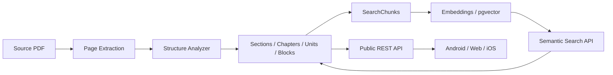
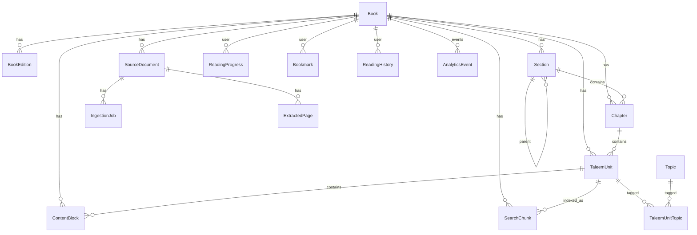
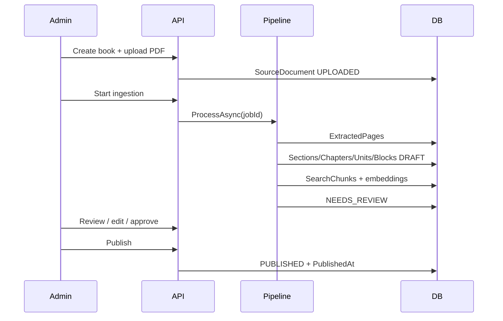
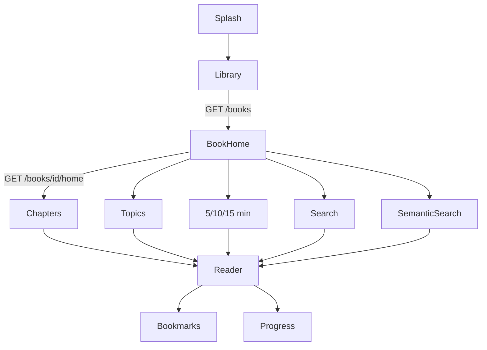
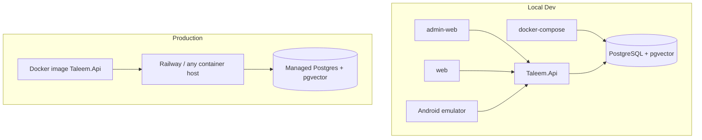

# Taleem Platform Architecture

**Books are data. The content/reading/search platform is the product.**

No client (Android, Web, future iOS) contains book-specific logic. Adding *Fazail-e-Amaal* or any authorized book requires only admin upload → ingest → review → publish.

---

## 1. Solution Structure

```
Taleem/
├── backend/                 # ASP.NET Core Web API monorepo solution
│   ├── src/
│   │   ├── Taleem.Api              # HTTP, auth, versioning, Swagger
│   │   ├── Taleem.Application      # Use-cases, DTOs, validators, pipeline ports
│   │   ├── Taleem.Domain           # Entities, enums, domain rules
│   │   └── Taleem.Infrastructure   # EF Core, pgvector, PDF, embeddings, storage
│   └── tests/
│       └── Taleem.Tests
├── admin-web/               # Next.js admin portal (upload/review/publish)
├── web/                     # Next.js public reader
├── android/                 # Kotlin + Jetpack Compose client
├── infra/                   # Docker, deploy notes
└── docs/                    # Supplemental docs
```

### Dependency direction

```
Api → Application → Domain
Api → Infrastructure → Application → Domain
```

Infrastructure implements Application ports (`IDocumentExtractor`, `IEmbeddingService`, etc.).

---

## 2. Dual Content Representations

### A. Canonical structured content (navigation & reading)

```
Book
 └ Section (optional nesting via ParentSectionId)
     └ Chapter
         └ TaleemUnit
             └ ContentBlock[]
```

Used by: Library, Book Home, Sections, Chapters, Topics, Reader, duration-based Ta'leem, References.

### B. Search representation (retrieval only)

```
TaleemUnit / ContentBlocks
       ↓
SearchChunk (ChunkText + Metadata JSONB + Embedding vector)
       ↓
pgvector similarity / PostgreSQL FTS
```

Search results **always resolve** to canonical IDs (`BookId`, `TaleemUnitId`, pages).  
Never return embedding-generated text as the reading surface.



---

## 3. Database ER Model



### Lifecycle states

`UPLOADED → PROCESSING → DRAFT → NEEDS_REVIEW → APPROVED → PUBLISHED → ARCHIVED`  
(+ `FAILED` on pipeline errors)

**Only `PUBLISHED` content is returned by `/api/v1/*` public endpoints.**

---

## 4. API Contracts

### Public (`/api/v1`)

| Method | Path | Purpose |
|--------|------|---------|
| GET | `/books` | Published library |
| GET | `/books/{idOrSlug}` | Book detail |
| GET | `/books/{id}/home` | Generic dashboard payload |
| GET | `/books/{id}/sections` | Sections |
| GET | `/books/{id}/chapters` | Chapters |
| GET | `/chapters/{id}` | Chapter detail |
| GET | `/chapters/{id}/units` | Units in chapter |
| GET | `/units/{id}` | Reader payload (blocks) |
| GET | `/books/{id}/topics` | Topics |
| GET | `/books/{id}/topics/{topicId}/units` | Units by topic |
| GET | `/books/{id}/taleem?minutes=10` | Duration-based selection |
| GET | `/books/{id}/search?q=` | Keyword / FTS |
| POST | `/search/semantic` | Vector retrieval |
| POST | `/events` | Anonymous analytics events |
| GET | `/health`, `/health/ready` | Probes |

### Admin (`/api/admin/v1`) — authenticated

Book CRUD, upload, start ingestion, job status, review edits (structure/blocks/topics), approve, publish, hard-delete book (cascade content + storage; shared Topics preserved).

---

## 5. Ingestion Pipeline

Pluggable ports:

| Port | Responsibility |
|------|----------------|
| `IDocumentExtractor` | PDF → **layout IR** (pages/elements/bboxes) + derived page text |
| `IDocumentStructureAnalyzer` | Furniture/TOC/heading/hierarchy/TaleemUnit analysis on IR |
| `IBookNormalizer` | Normalize derived content text (not the primary structure source) |
| `IChunkGenerator` | Logical SearchChunks from units/blocks |
| `IEmbeddingService` | Vector generation (real or fake) |
| `IBookPublisher` | State transition to PUBLISHED |

Ingestion must **not** start from flattened `page.Text`. PdfPig word/letter geometry is preserved in `DocumentPage` / `DocumentElement`. Page numbers, headers, and footers are classified as furniture and excluded from titles/units.



Religious safety:

- Never fabricate Quran/Hadith text.
- Low extraction confidence → review flags.
- Admin compares original page vs structured content before approval.

---

## 6. Chunking Strategy

- Prefer semantic/logical boundaries (unit, heading+body, hadith+translation).
- Never intentionally split Quran/Hadith from immediate translation/reference.
- A `SearchChunk` may span multiple `ContentBlock`s.
- Configurable max chars / overlap via `ChunkingOptions`.
- Metadata JSONB stores: `chapterId`, `pageStart`, `pageEnd`, `blockIds`.

---

## 7. Embedding Provider

`IEmbeddingService`:

- **FakeEmbeddingService** — deterministic hash vectors when no API key (local/dev).
- **OpenAIEmbeddingService** (or compatible) — when `EMBEDDING_PROVIDER` + `EMBEDDING_API_KEY` configured.

Dimensions and model are configuration-driven. Never commit secrets.

---

## 8. Android Flow



- Online-first; DataStore for prefs / last location only.
- MVVM + Hilt + Retrofit; no PDF parsing on device.
- ContentBlocks rendered by `BlockType` with RTL for Arabic/Urdu.

---

## 9. Web Flow

Shareable routes:

- `/books/{slug}` — book home
- `/books/{slug}/chapters/{chapterId}` — chapter
- `/read/{unitId}` — reader
- `/books/{slug}/search` — keyword
- `/books/{slug}/semantic-search` — semantic
- `/books/{slug}/topics/{topicId}` — topic units

Admin: `/` dashboard, books, upload, jobs, review, publish, delete.

---

## 10. Deployment Architecture



Application code is **not** coupled to Railway/AWS/Azure. Same image + env vars everywhere.

---

## 11. Future ADK / Agent Tools

Prepared (not mandatory for V1):

- `searchBook`, `getBook`, `getChapter`, `getTaleemByTopic`, `getTaleemByDuration`, `getRelatedReadings`, `getBookProgress`

Agents operate only over **published** canonical content.

---

## 12. Deletion Contract

Admin hard-delete removes: Book, editions, sources, pages, jobs, sections, chapters, units, blocks, unit-topic links, search chunks/embeddings, stored PDF.  
Shared `Topic` rows are retained if referenced elsewhere (or orphaned topics optionally cleaned when unused).

---

## 13. Acceptance Criterion

Upload any authorized book → publish → Android/Web see it with zero client code changes.
