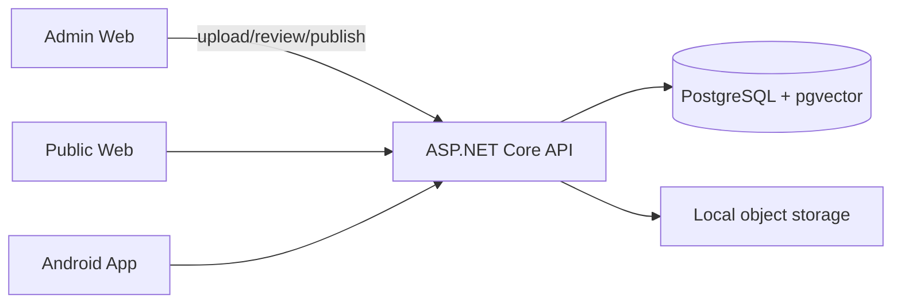

# Taleem

Production-oriented multi-book Islamic reading and Ta'leem platform.

**Books are data. The content/reading/search platform is the product.**

Android, Web, and future iOS consume the same backend. Uploading an authorized book (e.g. Fazail-e-Amaal) must not require client code changes.

See [ARCHITECTURE.md](./ARCHITECTURE.md) for ER model, pipeline, and API contracts.

---

## Architecture at a glance



### Content model

| Representation | Purpose |
|----------------|---------|
| **Canonical** `Book → Section → Chapter → TaleemUnit → ContentBlock` | Library, navigation, reader, Ta'leem |
| **Search** `SearchChunk + Embedding` | Keyword + semantic retrieval only |

Search results always resolve to canonical IDs. Never treat embeddings as the reading surface.

---

## Repository layout

```
/backend      ASP.NET Core API + Domain/Application/Infrastructure
/admin-web    Next.js admin portal
/web          Next.js public reader
/android      Kotlin Compose client
/infra        Deployment notes
/docs         Extra docs
```

---

## Prerequisites (Windows)

- .NET 10 SDK
- Node.js 20+
- Docker Desktop (for PostgreSQL + pgvector) — **required for local DB**
- Android Studio (for the Android app)

This machine may not have Docker installed yet; install Docker Desktop, then continue.

---

## One-command infrastructure

```powershell
docker compose up -d
```

Starts:

- PostgreSQL 16 + pgvector on `localhost:5432`
- Taleem API on `http://localhost:5080`

Default DB credentials: `taleem` / `taleem` / database `taleem`.

---

## Backend (without Docker for API)

```powershell
# Terminal 1 — database only
docker compose up -d db

# Terminal 2 — API
cd backend
dotnet restore
dotnet ef database update --project src/Taleem.Infrastructure --startup-project src/Taleem.Api
dotnet run --project src/Taleem.Api
```

API: [http://localhost:5080](http://localhost:5080)  
Swagger: [http://localhost:5080/swagger](http://localhost:5080/swagger)  
Health: `/health`, `/health/ready`

Migrations apply automatically on startup (`MigrateAsync`) after ensuring the `vector` extension exists.

### Tests

```powershell
cd backend
dotnet test
```

---

## Admin web

```powershell
cd admin-web
copy .env.local.example .env.local   # if needed
npm install
npm run dev
```

Open [http://localhost:3000](http://localhost:3000)

Dev login (change in production):

- Username: `admin`
- Password: `changeme-dev-only`

### Upload → publish workflow

1. Login
2. **Upload book** — create metadata + PDF (do **not** commit PDFs)
3. Watch ingestion progress
4. **Review** original page vs structured units/blocks; edit as needed
5. **Approve** → **Publish**
6. Public API `GET /api/v1/books` returns the book

### Delete test content

On the book detail page, type the book **slug** and delete permanently. This removes:

source PDF, extracted pages, sections/chapters/units/blocks, search chunks/embeddings, and the book row. Shared topics used by other books are preserved.

---

## Public web

```powershell
cd web
copy .env.local.example .env.local
npm install
npm run dev -- -p 3001
```

Open [http://localhost:3001](http://localhost:3001)

Shareable routes:

- `/books/{slug}`
- `/books/{slug}/chapters/{chapterId}`
- `/read/{unitId}`
- `/books/{slug}/search`
- `/books/{slug}/semantic-search`

---

## Android

See [android/README.md](./android/README.md).

1. Start API on port `5080`
2. Open `android/` in Android Studio
3. Run `developmentDebug` (emulator → `http://10.0.2.2:5080/`)

Screens: Library → Book Home (dynamic) → Chapters/Topics/Reader/Search/Semantic/Ta'leem.

---

## Testing with the temporary Salah PDF

Use **only** as local test input (no redistribution rights assumed):

`https://learnislam4free.org/wp-content/uploads/2025/08/salah-islamic-prayer.pdf`

1. Download locally (do not commit)
2. Admin → Upload book → select the PDF
3. Review → Approve → Publish
4. Verify on Web + Android
5. **Delete** the book when finished

Later: upload an authorized production book through the same UI. No Android/web feature changes.

---

## Embedding configuration

| Variable | Values |
|----------|--------|
| `EMBEDDING_PROVIDER` / `Embedding__Provider` | `fake` (default) or `openai` |
| `EMBEDDING_API_KEY` | Required for openai |
| `EMBEDDING_MODEL` | e.g. `text-embedding-3-small` |
| `Embedding__Dimensions` | `1536` |

Never commit API keys. See `.env.example`.

With `fake`, deterministic local vectors enable semantic retrieval offline.

---

## Security notes

- Admin routes: `/api/admin/v1/*` (JWT)
- Public routes: `/api/v1/*` — **PUBLISHED only**
- Upload validation: PDF MIME/extension, size limit, generated storage keys (no path traversal)
- Dev admin credentials are placeholders — replace with real identity for production

---

## Deployment

Containerize backend (`backend/Dockerfile`). Same image runs on Railway or any container host. See [infra/DEPLOYMENT.md](./infra/DEPLOYMENT.md).

---

## Future ADK / agent

Not required for V1. Architecture supports tools over published canonical content:

`searchBook`, `getBook`, `getChapter`, `getTaleemByTopic`, `getTaleemByDuration`, `getRelatedReadings`, `getBookProgress`

---

## Definition of done checklist

1. `docker compose up -d` (or `db` + local API)
2. Admin login → create book → upload PDF → ingest
3. Review / edit → approve → publish
4. `GET /api/v1/books` shows the book
5. Web + Android navigate, read, search, semantic search, 5/10/15 Ta'leem
6. Admin delete removes the test book from all clients
7. A different authorized book works without client code changes
